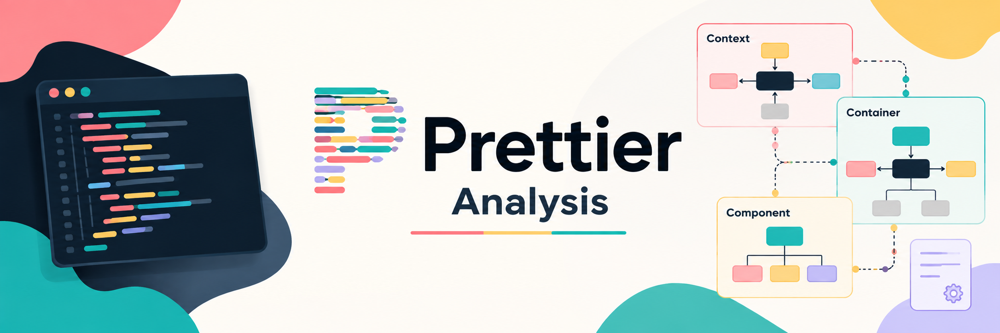

# Prettier Analysis — Software Design & Architecture

Prettier Analysis is an academic team project developed for the **Software Design and Architecture** course (2025-2026) at **Politecnico di Torino**.

The project focuses on analyzing the architecture and design of [Prettier](https://github.com/prettier/prettier), an open-source, opinionated code formatter.

Rather than developing a new application, the team investigated an existing software system to understand its architectural organization, internal dependencies, design patterns, and key design decisions.

## Project Objectives

The main objectives of the project were to:

- Understand Prettier's overall architecture and internal organization.
- Model the system using the **C4 Model**.
- Evaluate architectural principles and software quality attributes.
- Analyze code dependencies and knowledge dependencies between modules.
- Identify and examine design patterns used in the codebase.
- Discuss alternative design approaches and their trade-offs.

## System Overview

Prettier is an opinionated code formatter designed to enforce consistent code styling across software projects.

It processes source code by parsing it into an **Abstract Syntax Tree (AST)**, transforming it into an intermediate document representation, and generating formatted output according to predefined formatting rules.

Its modular architecture supports multiple programming languages through specialized parsers and printers.

The project examines Prettier's purpose, main stakeholders, system organization, and general characteristics.

**Full documentation:** [System Overview](Overview.md)

## Software Architecture

The architectural analysis uses the **C4 Model**, with diagrams created using Structurizr DSL.

Three architectural levels were examined:

- **System Context:** Identifies Prettier's users, external systems, and interactions with development environments.
- **Container View:** Describes the system's main architectural responsibilities, including the CLI, API, plugins, processing engine, and document engine.
- **Component View:** Examines the internal formatting workflow, including configuration handling, parsing, AST processing, and printing.

The analysis also considers Clean Architecture, SOLID principles, coupling, cohesion, extensibility, and testability.

**Full documentation and C4 diagrams:** [Software Architecture](Software_Architecture.md)

## Software Design

The software design analysis focuses on two main areas.

### Dependency Analysis

The team investigated:

- **Code dependencies:** Static relationships between modules, including afferent coupling, efferent coupling, and architectural dependency hubs.
- **Knowledge dependencies:** Logical relationships identified through Git co-change analysis, examining files that frequently evolve together.

Tools such as `madge`, `dependency-cruiser`, Git, PowerShell, and command-line utilities were used to support the analysis.

### Design Pattern Analysis

Five design patterns were examined in the Prettier codebase:

- **Strategy:** Language-specific parsing and printing behavior.
- **Visitor:** Traversal and processing of Abstract Syntax Trees.
- **Composite:** Hierarchical representation of formatting documents.
- **Facade:** Simplified access to complex internal functionality.
- **Builder:** Construction of intermediate document structures.

For each pattern, the team analyzed its role, implementation, and possible alternatives, discussing their advantages and disadvantages.

**Full documentation and design pattern diagrams:** [Software Design](Software_Design.md)

## Tools & Technologies

| Category | Tools & Technologies |
|---|---|
| Analyzed system | Prettier |
| Primary language of analyzed codebase | JavaScript |
| Architecture modeling | C4 Model, Structurizr DSL |
| Dependency analysis | madge, dependency-cruiser |
| Repository analysis | Git, Git co-change analysis |
| Scripting and data processing | PowerShell, command-line utilities |
| Documentation | Markdown |
| Version control and collaboration | Git, GitHub |

## Project Structure

```text
prettier-architecture-analysis/
├── assets/
│   └── cover.png
├── media/
├── journals/
├── draft/
├── Overview.md
├── Software_Architecture.md
├── Software_Design.md
└── README.md
```

## Project Documentation

The complete analysis is available in three dedicated documents:

- **[Overview](Overview.md):** System purpose, stakeholders, characteristics, and general organization.
- **[Software Architecture](Software_Architecture.md):** C4 diagrams, architectural structure, SOLID principles, and software quality attributes.
- **[Software Design](Software_Design.md):** Code and knowledge dependencies, coupling metrics, and design pattern analysis.

The `media/` directory contains the diagrams supporting the architectural and design analyses. The `journals/` and `draft/` directories preserve the team's working materials.

## Disclaimer

This repository contains an independent academic analysis of Prettier, developed for educational purposes.

Prettier is an open-source project maintained by its respective contributors. This repository does not contain an implementation of Prettier and is not affiliated with its maintainers.

**Prettier is an existing open-source project developed and maintained by its respective contributors.** This repository does not contain an implementation of Prettier and is not affiliated with its maintainers.
